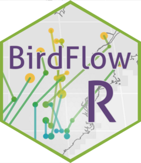

<!-- README.md is generated from README.Rmd. Please edit that file -->

```{r, include = FALSE}
knitr::opts_chunk$set(
  collapse = TRUE,
  comment = "#>",
  fig.path = "man/figures/README-",
  out.width = "100%", 
  dev = "ragg_png",
  dpi = 100
)

set.seed(1)
```

# BirdFlowR <a href="https://birdflow-science.github.io/BirdFlowR/"></a>

<!-- badges: start -->
  [](https://github.com/birdflow-science/BirdFlowR/actions/workflows/R-CMD-check.yaml)
[](https://app.codecov.io/gh/birdflow-science/BirdFlowR?branch=main)
<!-- badges: end -->


An R package to predict changes in bird distributions and generate synthetic 
migration routes based on BirdFlow models.


## Installation

Install just the package:
```{r install, eval = FALSE}
# install.packages("pak")
pak::pak("birdflow-science/BirdFlowR")
```

Or install with example data and optional additional packages:
```{r install everything, eval = FALSE}
pak::pak("birdflow-science/BirdFlowR", dependencies = TRUE)
```
See the 
[Installation vignette](https://birdflow-science.github.io/BirdFlowR/articles/Installation.html) 
for more information and help troubleshooting.

## Usage 

The two primary functions are `route()` to generate synthetic routes,
and `predict()` to project distributions.

### `route()`

`route()` generates synthetic migration routes from user
specified starting locations. If unspecified, locations are
sampled from the initial species distribution.
```{r route}
library(BirdFlowR)
library(BirdFlowExamples) 

bf <- amewoo 
species(bf)

# Generate and plot routes for the prebreeding migration 
rts <- route(bf, n = 10, season = "prebreeding")
plot_routes(rts, bf)

```

### `predict()`

`predict()` propagates an input distribution forward or backward in time.
In this example we predict where birds from a randomly selected location in the winter will be in the summer.
```{r predict}
set.seed(1)
initial_distribution <- get_distr(bf, 1)
location <- sample_distr(initial_distribution)
forecast <- predict(bf, distr = location, start = 1, end = 26, direction = "forward")
plot_distr(forecast[, c(1, 7, 14, 19)], bf, dynamic_scale = TRUE)

```

## Learn more

- `vignette("BirdFlowR")` has a longer introduction to the package, and how to
  use `predict()` and `route()` to project bird distributions and movement. 
- `vignette("Installation")` for detailed installation instructions.
- `vignette("Preprocess")` covers downloading and formatting data for model 
  fitting with `preprocess_species()`, importing fitted models with 
  `import_birdflow()`, and reducing model size with `sparsify()`.   
- Read the paper:
  - [BirdFlow: Learning Seasonal Bird Movements from Citizen Science Data](https://www.biorxiv.org/content/10.1101/2022.04.12.488057v1) Miguel Fuentes, Benjamin M. Van Doren, Daniel Fink, Daniel Sheldon bioRxiv 2022.04.12.488057; doi: https://doi.org/10.1101/2022.04.12.488057


