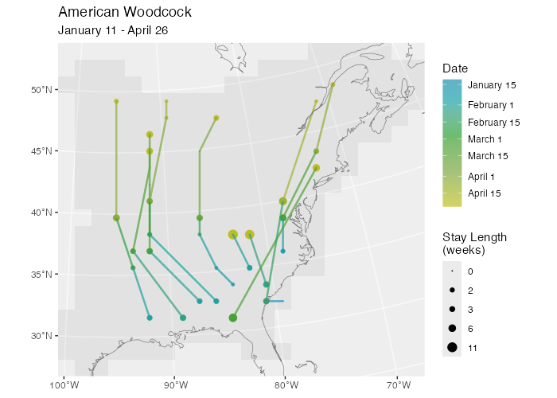
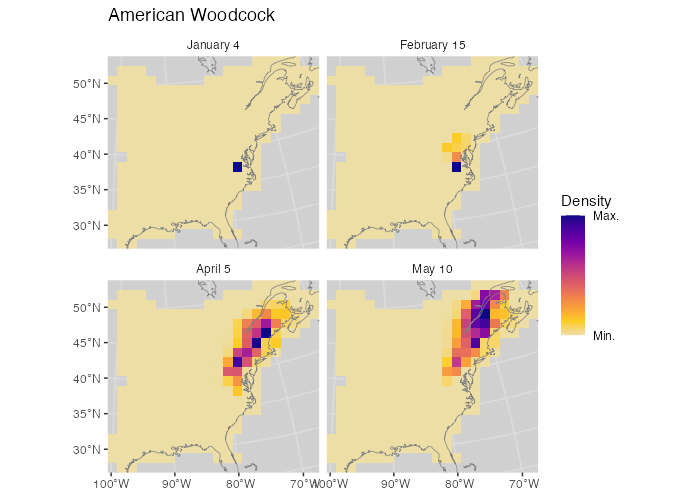

# BirdFlowR

An R package to predict changes in bird distributions and generate
synthetic migration routes based on BirdFlow models.

## Installation

Install just the package:

``` r

# install.packages("pak")
pak::pak("birdflow-science/BirdFlowR")
```

Or install with example data and optional additional packages:

``` r

pak::pak("birdflow-science/BirdFlowR", dependencies = TRUE)
```

See the [Installation
vignette](https://birdflow-science.github.io/BirdFlowR/articles/Installation.html)
for more information and help troubleshooting.

## Usage

The two primary functions are
[`route()`](https://birdflow-science.github.io/BirdFlowR/reference/route.md)
to generate synthetic routes, and
[`predict()`](https://birdflow-science.github.io/BirdFlowR/reference/predict.BirdFlow.md)
to project distributions.

### `route()`

[`route()`](https://birdflow-science.github.io/BirdFlowR/reference/route.md)
generates synthetic migration routes from user specified starting
locations. If unspecified, locations are sampled from the initial
species distribution.

``` r

library(BirdFlowR)
library(BirdFlowExamples) 

bf <- amewoo 
species(bf)
#> [1] "American Woodcock"

# Generate and plot routes for the prebreeding migration 
rts <- route(bf, n = 10, season = "prebreeding")
plot_routes(rts, bf)
```



### `predict()`

[`predict()`](https://birdflow-science.github.io/BirdFlowR/reference/predict.BirdFlow.md)
propagates an input distribution forward or backward in time. In this
example we predict where birds from a randomly selected location in the
winter will be in the summer.

``` r

set.seed(1)
initial_distribution <- get_distr(bf, 1)
location <- sample_distr(initial_distribution)
forecast <- predict(bf, distr = location, start = 1, end = 26, direction = "forward")
plot_distr(forecast[, c(1, 7, 14, 19)], bf, dynamic_scale = TRUE)
```



## Learn more

- [`vignette("BirdFlowR")`](https://birdflow-science.github.io/BirdFlowR/articles/BirdFlowR.md)
  has a longer introduction to the package, and how to use
  [`predict()`](https://birdflow-science.github.io/BirdFlowR/reference/predict.BirdFlow.md)
  and
  [`route()`](https://birdflow-science.github.io/BirdFlowR/reference/route.md)
  to project bird distributions and movement.
- [`vignette("Installation")`](https://birdflow-science.github.io/BirdFlowR/articles/Installation.md)
  for detailed installation instructions.
- [`vignette("Preprocess")`](https://birdflow-science.github.io/BirdFlowR/articles/Preprocess.md)
  covers downloading and formatting data for model fitting with
  [`preprocess_species()`](https://birdflow-science.github.io/BirdFlowR/reference/preprocess_species.md),
  importing fitted models with
  [`import_birdflow()`](https://birdflow-science.github.io/BirdFlowR/reference/export_import_birdflow.md),
  and reducing model size with
  [`sparsify()`](https://birdflow-science.github.io/BirdFlowR/reference/sparsify.md).  
- Read the paper:
  - [BirdFlow: Learning Seasonal Bird Movements from Citizen Science
    Data](https://www.biorxiv.org/content/10.1101/2022.04.12.488057v1)
    Miguel Fuentes, Benjamin M. Van Doren, Daniel Fink, Daniel Sheldon
    bioRxiv 2022.04.12.488057; doi:
    <https://doi.org/10.1101/2022.04.12.488057>
